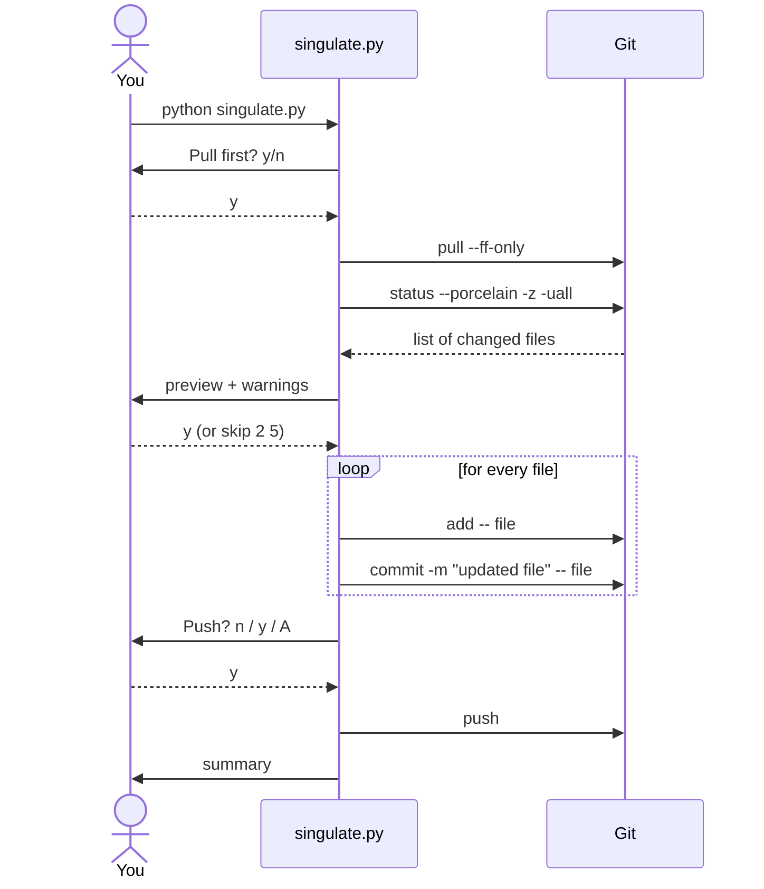
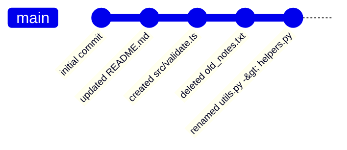
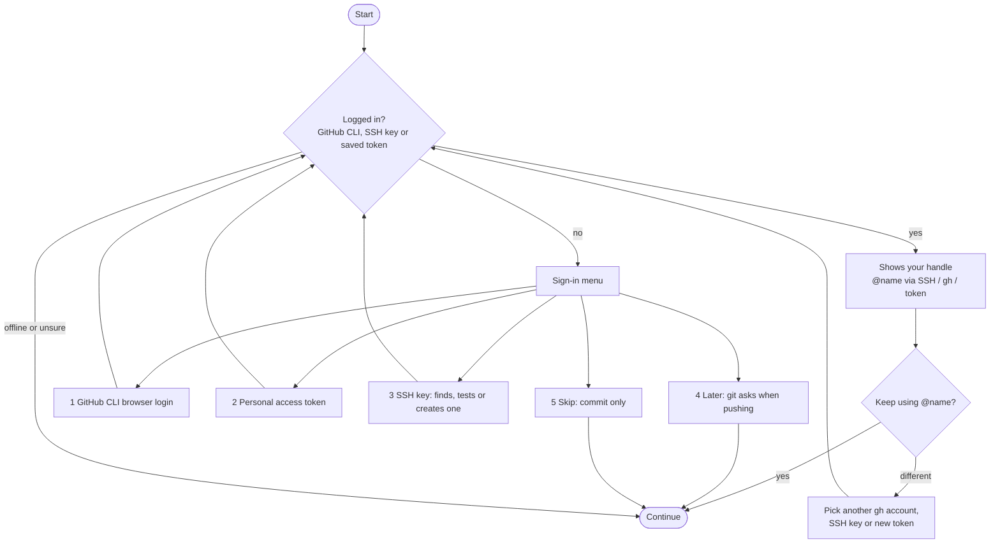
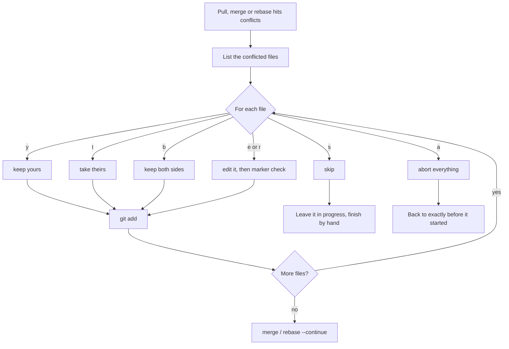

<div align="center">


<br>

[](https://github.com/mehedyk/Singulate/releases/latest)


<sub><i><b>sin·gu·late</b> (v.) to separate into single, individual units</i></sub>

### Stop committing everything in one blob.
**Run one command, get a clean commit for every file.**

[Versions](#-pick-your-version) &nbsp;·&nbsp; [Demo](#-live-demo) &nbsp;·&nbsp; [Pro](#-singulate-pro) &nbsp;·&nbsp; [How it works](#-how-it-works) &nbsp;·&nbsp; [Safety](#-safety-guards) &nbsp;·&nbsp; [Download](#-download--install) &nbsp;·&nbsp; [Usage](#-usage) &nbsp;·&nbsp; [FAQ](#-faq)

Developed by [**mehedyk**](https://mehedy.netlify.app)

</div>


## ✨ What is it?

`singulate.py` scans your repo, shows you what changed, and makes **one separate commit for every changed or new file**, with an automatic message like `updated app.py` or `created utils/helpers.js`. When it's done it can push for you.

No `git add .`. No typing twelve commit messages by hand. One Python file, **zero dependencies**.

<div align="center">

</div>


## 🧰 Pick your version

| | `simple_push.py` | `singulate.py` | `singulate_pro.py` |
|---|:---:|:---:|:---:|
| **For** | first repos | everyday use | messy, real-world repos |
| One commit per file | ❌ | ✅ | ✅ |
| Preview, skip files, secret + size guards | ❌ | ✅ | ✅ |
| Content scan for API keys / tokens | ❌ | ❌ | ✅ |
| Login check, account switching | ❌ | ❌ | ✅ |
| Merge / rebase conflict guide | ❌ | ❌ | ✅ |
| Handles diverged pulls, rejected pushes, detached HEAD | ❌ | ❌ | ✅ |
| Undo the last run, `--doctor` report | ❌ | ❌ | ✅ |
| Automated tests | ❌ | ❌ | ✅ (50) |


## 🎬 Live demo

<div align="center">

</div>

<details>
<summary><b>Prefer plain text? (copy-friendly)</b></summary>

```text
$ python singulate.py
Pull first? [y/N] n

  1. ~ updated  README.md
  2. + created  src/validate.ts
  3. - deleted  old_notes.txt
  4. > renamed  utils.py -> helpers.py
  5. + created  .env   (SENSITIVE?)

.env looks like a secret. [e]xclude / [i]nclude / [a]bort: e

Commit these 4 file(s), one commit each? [Y]es/[n]o/skip: y
✔ updated README.md
✔ created src/validate.ts
✔ deleted old_notes.txt
✔ renamed utils.py -> helpers.py
Push?  [n] no  [y] current branch ('main')  [A] another branch: y
Pushed to origin/main

Summary
  Committed: 4  (1 updated, 1 created, 1 deleted, 1 renamed)
  Skipped:   1
  Pushed to: origin/main
```

</details>


## 🧭 How it works

<div align="center">

</div>

### The conversation between you, the script, and Git



### What your history looks like afterwards



### The push question


## 🛡 Safety guards

<div align="center">

</div>

| Guard | What it does |
|-------|--------------|
| 🔑 **Secret guard** | Flags `.env`, `*.pem`, `*.key`, `id_rsa`, `credentials.json` and similar. You choose: **e**xclude (default), **i**nclude, or **a**bort. `.env.example` is not flagged. |
| 📦 **Size guard** | Warns above 50 MB. Files above 100 MB are skipped automatically, because GitHub rejects them. |
| 🔒 **Scoped commits** | Each commit contains only its own file, even if other files are already staged. |
| 🚫 **No force-push** | The tool never rewrites history and never uses `--force`. |
| 🔀 **Safe pull** | Uses `--ff-only`, so you never land in a surprise merge editor. |
| 🧪 **Dry run** | `--dry-run` prints every git command it *would* run and changes nothing. |
| ⛔ **Ctrl+C safe** | Stops cleanly and prints what was already committed. |


## 🚀 Features

| | Feature | Details |
|---|---|---|
| 👁 | **Preview first** | Numbered list of changes; type `s 2 5` to leave files out |
| 🧩 | **All change types** | new, modified, deleted and renamed files |
| 📁 | **New folders** | every file inside a new folder is listed individually |
| 🔤 | **Weird filenames** | spaces, quotes and `*` in names just work |
| 🌿 | **Smart push** | `n` no · `y` current branch · `A` another branch |
| 🏷 | **Message prefix** | `--prefix feat:` → `feat: updated app.py` |
| 🎨 | **Colored output** | respects `NO_COLOR` |
| 🤖 | **Automation flags** | `--yes`, `--pull`, `--push` for scripts |


## 📦 Download & install

Pick whichever is easiest. **Option 1 needs no Python at all.**

### Option 1: download the ready-made app

Get the file for your system from the [**latest release**](https://github.com/mehedyk/Singulate/releases/latest):

| | 🪟 Windows | 🍎 macOS (Apple Silicon) | 🐧 Linux |
|---|---|---|---|
| **Pro** (recommended) | [singulate-pro-windows.exe](https://github.com/mehedyk/Singulate/releases/latest/download/singulate-pro-windows.exe) | [singulate-pro-macos](https://github.com/mehedyk/Singulate/releases/latest/download/singulate-pro-macos) | [singulate-pro-linux](https://github.com/mehedyk/Singulate/releases/latest/download/singulate-pro-linux) |
| **Normal** | [singulate-windows.exe](https://github.com/mehedyk/Singulate/releases/latest/download/singulate-windows.exe) | [singulate-macos](https://github.com/mehedyk/Singulate/releases/latest/download/singulate-macos) | [singulate-linux](https://github.com/mehedyk/Singulate/releases/latest/download/singulate-linux) |
| **Simple** | [simple-push-windows.exe](https://github.com/mehedyk/Singulate/releases/latest/download/simple-push-windows.exe) | [simple-push-macos](https://github.com/mehedyk/Singulate/releases/latest/download/simple-push-macos) | [simple-push-linux](https://github.com/mehedyk/Singulate/releases/latest/download/simple-push-linux) |

These are command-line programs: run them **inside the project folder you want to commit**, from a terminal. (If you double-click one in Explorer, it explains that and waits for you to press Enter.)

<details open>
<summary><b>🪟 Windows</b></summary>

1. Download `singulate-pro-windows.exe`.
2. Put it somewhere permanent and add that folder to your `PATH` (PowerShell):

```powershell
mkdir $HOME\bin -Force
move $HOME\Downloads\singulate-pro-windows.exe $HOME\bin\singulate-pro.exe
[Environment]::SetEnvironmentVariable("Path", [Environment]::GetEnvironmentVariable("Path","User") + ";$HOME\bin", "User")
```

3. Open a **new** terminal (PowerShell, Command Prompt, or Git Bash), go to your project, and run:

```powershell
cd C:\path\to\your-project
singulate-pro
```

> **"Windows protected your PC"?** The app isn't code-signed (that costs money), so SmartScreen warns about unknown apps. Click **More info → Run anyway**. Some antivirus tools also flag every PyInstaller-built program; if you'd rather not trust a binary, use Option 2 or 3, or build it yourself (Option 4). The source is right here.

</details>

<details>
<summary><b>🍎 macOS</b></summary>

```bash
chmod +x singulate-pro-macos
xattr -d com.apple.quarantine singulate-pro-macos    # lets Gatekeeper run it
sudo mv singulate-pro-macos /usr/local/bin/singulate-pro
cd ~/your-project && singulate-pro
```

The macOS download is built for Apple Silicon (M1 and newer). On an Intel Mac use Option 2 or 3.

</details>

<details>
<summary><b>🐧 Linux</b></summary>

```bash
chmod +x singulate-pro-linux
mkdir -p ~/.local/bin && mv singulate-pro-linux ~/.local/bin/singulate-pro
cd ~/your-project && singulate-pro
```

</details>

<details>
<summary><b>🔐 Verify your download (optional)</b></summary>

Every release includes `SHA256SUMS.txt`. Compare it with your file:

```powershell
CertUtil -hashfile singulate-pro-windows.exe SHA256     # Windows
```
```bash
shasum -a 256 singulate-pro-macos                       # macOS
sha256sum singulate-pro-linux                           # Linux
```

</details>

### Option 2: install with pip / pipx (needs Python 3.8+)

```bash
pipx install git+https://github.com/mehedyk/Singulate.git      # or: pip install git+https://github.com/mehedyk/Singulate.git
```

This gives you three commands that work in any folder:

| Command | Version |
|---|---|
| `singulate-pro` | Pro |
| `singulate` | Normal |
| `singulate-simple` | Simple |

Update later with `pipx upgrade singulate`.

### Option 3: run the script directly

See [Run from source](#-run-from-source) below. Nothing to install.

### Option 4: build the app yourself

An app can only be built on the system it is for, so to get a Windows `.exe` run this **on Windows**:

```bash
git clone https://github.com/mehedyk/Singulate.git
cd Singulate
python build.py
```

The files appear in `dist/` (`singulate-pro-windows.exe` and friends). Needs Python 3.8+; PyInstaller is installed automatically.

<details>
<summary><b>🏷 For maintainers: publishing a release</b></summary>

Push a version tag and GitHub Actions builds the Windows, macOS and Linux apps and attaches them (plus `SHA256SUMS.txt`) to a new release:

```bash
git tag v1.0.0
git push origin v1.0.0
```

The workflow lives in `.github/workflows/release.yml`; you can also start it by hand from the **Actions** tab.

</details>


## 🧑‍💻 Run from source

You need **Python 3.8+** and **Git**.

```bash
git clone https://github.com/mehedyk/Singulate.git
cd Singulate
```

That's it. There is nothing to `pip install`.

<details>
<summary><b>Use it from any repo (optional)</b></summary>

```bash
# macOS / Linux / Git Bash: create a git alias, then run `git sing` anywhere
git config --global alias.sing '!python /full/path/to/singulate.py'
```

On Windows you can instead save `singulate.bat` somewhere on your `PATH`:

```bat
@python C:\full\path\to\singulate.py %*
```

</details>

## 🕹 Usage

Run it **inside the repo you want to commit** (if you installed the app or used pip, type `singulate-pro`, `singulate` or `singulate-simple` instead of `python <file>.py`):

```bash
python singulate.py
```

| Flag | What it does |
|------|--------------|
| `--dry-run` | Show what would happen, change nothing |
| `--prefix feat:` | Message becomes `feat: updated app.py` |
| `--pull` / `--no-pull` | Pull (or not) without asking |
| `--push` / `--no-push` | Push current branch (or not) without asking |
| `-y`, `--yes` | No questions. Secrets and >100 MB files are auto-skipped; no pull/push unless you pass `--pull` / `--push` |

```bash
python singulate.py --dry-run                 # try it safely first
python singulate.py --prefix chore: --push    # "chore: updated ..." for each file, then push
python singulate.py -y --pull --push          # fully automatic
```

### Commit messages

| Change | Symbol | Message |
|--------|:------:|---------|
| new file | `+` | `created path/to/file` |
| modified | `~` | `updated path/to/file` |
| deleted | `-` | `deleted path/to/file` |
| renamed | `>` | `renamed old -> new` |


## 🏆 Singulate Pro

```bash
python singulate_pro.py
```

Everything the normal version does, plus the things that usually make people give up on a git helper.

### Login check and account switching

On every run it checks, quietly and without changing anything, whether you can push. If you are **logged in it just tells you who you are**; if not, it asks for what it needs.



```text
✔ Logged in to github.com as @mehedyk  (SSH key)
Keep using @mehedyk? [Y]es / [d]ifferent account:
```

- It also notices when you are logged in **but the account has no write access** to the repository (a very common "why is my push denied?" cause).
- Your token is never printed, never put on a command line, and never written to a file by this tool. It goes straight into git's own credential helper.
- A password or token typed into the remote URL is detected and can be moved to the credential helper.
- `--switch-account` jumps straight to choosing a different account, `--keep-account` skips the question.

### Conflicts, guided and never silent



"Yours" and "theirs" are translated for you, because git swaps them during a rebase. It will not mark a file resolved while `<<<<<<<` markers are still inside it. Binary files, "deleted by one side" conflicts, and conflicts caused by your own uncommitted edits (autostash) are all handled.

### The hard and uncommon cases

| Situation | What Pro does |
|---|---|
| Merge, rebase, cherry-pick or revert already in progress | Detects it and offers to resolve and continue, or abort |
| Branches diverged | Asks: merge, rebase, or stop |
| Push rejected (remote has newer commits) | Offers `pull --rebase`, then pushes again. Never force-pushes. |
| Push to a protected branch | Explains it and offers another branch |
| Detached HEAD | Offers to create a branch first |
| Empty repo, no upstream, no remote | Handles each with a clear message |
| Missing `user.name` / `user.email` | Asks and saves it for this repo only |
| Stale `.git/index.lock` | Asks before removing it |
| Hook changes a file or rejects the commit | Re-stages once, or shows the hook's message |
| GPG signing fails | Offers to commit unsigned for this run only |
| Submodules, symlinks, binary files | Labeled and handled; nested repos are skipped with a note |
| Permission-only (chmod) and case-only renames | Detected and committed with the right message |
| Hundreds of changed files | Offers one commit per top-level folder |
| Network down during push | Retries with backoff, then explains |
| API keys, tokens or private keys *inside* files | Content scan, same exclude/include/abort choice as secret file names |

### Safety net

- **`--undo`** puts the last run's commits back as uncommitted changes (only if nothing was pushed and the repo hasn't moved on). A backup ref `refs/singulate/backup-<time>` is created before every run.
- **Interrupted?** Run it again: it notices and continues, and `--undo` still covers both runs.
- **`--doctor`** prints a read-only report: git version, branch, upstream, conflicts, identity, hooks, LFS, login state.
- **`-y` is cautious by design**: it never resolves conflicts, never signs you in, and skips anything that looks like a secret.

| Flag | What it does |
|------|--------------|
| `--doctor` | Read-only report of repo and login state |
| `--undo` | Undo the last run (if not pushed) |
| `--dry-run` | Show what would happen, change nothing |
| `--switch-account` / `--keep-account` | Go straight to choosing an account / skip the question |
| `--no-login-check` | Don't check the login |
| `--no-content-scan` | Don't scan file contents for secrets |
| `--include-self` | Also commit Singulate's own script files (skipped by default) |
| `--group-threshold N` | Offer folder grouping above N files (default 200) |
| `--pull` `--no-pull` `--push` `--no-push` `--prefix` `-y` `-v` | Same as the normal version (`-v` prints every git command) |

> **Honest limits:** Pro never decides which side of a conflict is *correct*, you do. It is tested on Linux with real merge and rebase conflicts; Windows and macOS should work but are less tested. If something odd happens, `-v` shows every git command it ran.


## 🐣 For absolute beginners: `simple_push.py`

The no-frills version: *pull?* → `git add .` → **one** commit message → `git push`.

```bash
python simple_push.py
```

| | `singulate.py` | `simple_push.py` |
|---|:---:|:---:|
| One commit per file | ✅ | ❌ (one commit for everything) |
| Preview & skip files | ✅ | ❌ |
| Secret / size guards | ✅ | ❌ (stages everything, even `.env`) |
| Push to another branch | ✅ | ❌ |
| Lines of code to read | more | very few |

## 🔧 Under the hood

1. `git status --porcelain -z -uall` gives a script-friendly, one-line-per-file list.
2. Each file gets `git add -- <file>` then `git commit -m "<message>" -- <file>`. The trailing `-- <file>` makes the commit contain only that file.
3. Paths are passed as lists (never through a shell) with `--literal-pathspecs`, so unusual names are safe.

## ❓ FAQ

<details>
<summary><b>Is one commit per file a good idea?</b></summary>

Sometimes. It's great for quick progress snapshots, notes, assignments and docs. For a real feature where five files change together, one commit with a meaningful message is better history. Use `skip` in the preview, or commit those files yourself.

</details>

<details>
<summary><b>Will it commit the Singulate script itself into my project?</b></summary>

No. All three versions skip their own script files (and their sibling versions) when you copy them into a repo, including from a subfolder. If you really want them committed, for example in this tool's own repository, add `--include-self`. Once a copy is already tracked by git, edits to it are treated like any other file.

</details>

<details>
<summary><b>Will it ever force-push or rewrite history?</b></summary>

No.

</details>

<details>
<summary><b>Does it read or send my code anywhere?</b></summary>

No. It only runs local `git` commands, plus `pull` / `push` when you say so.

</details>

<details>
<summary><b>The prompt doesn't react to typing on Windows (Git Bash)</b></summary>

Try `winpty python singulate.py`, or run it from PowerShell / Command Prompt instead of Git Bash.

</details>

## 🤝 Contributing

[Issues](https://github.com/mehedyk/Singulate/issues) and pull requests are welcome. Run the tests with `python -m unittest discover -s tests`. See [CONTRIBUTING.md](CONTRIBUTING.md). Contributions are accepted under the same license (AGPL-3.0).

## 📜 License

Released under the **GNU Affero General Public License v3.0**, see [LICENSE](LICENSE).
In short: you may use, study and modify this code, but anything you distribute **or run as a network service** based on it must be published under the same license, with source and with credit preserved.


<div align="center">

Developed with ❤ by **[mehedyk](https://mehedy.netlify.app)** &nbsp;·&nbsp; &copy; 2026 mehedyk

⭐ If this saved you time, [a star on the repo](https://github.com/mehedyk/Singulate) is appreciated.

</div>
