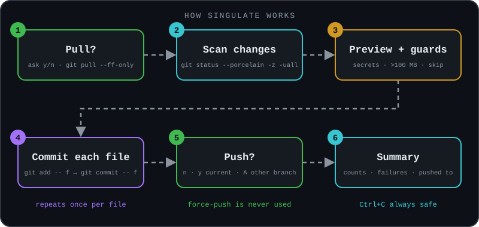
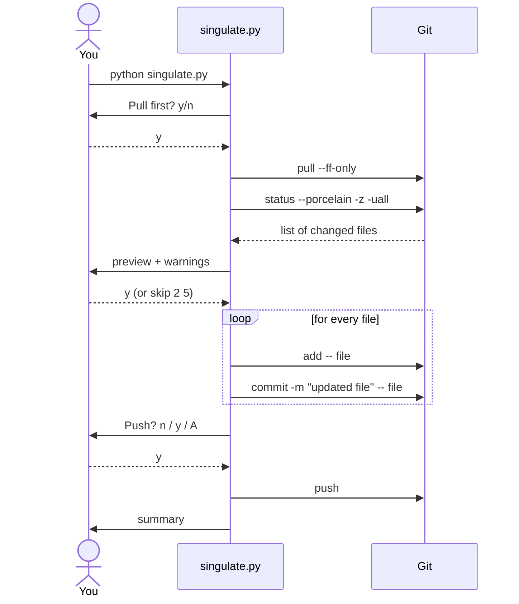
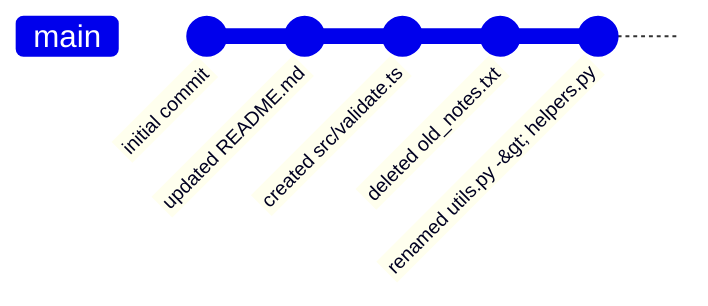
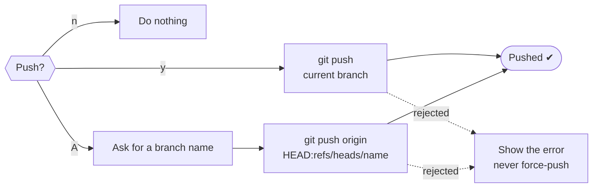

<div align="center">


<br>


<sub><i><b>sin·gu·late</b> (v.) to separate into single, individual units</i></sub>

### Stop committing everything in one blob.
**Run one command, get a clean commit for every file.**

[Demo](#-live-demo) &nbsp;·&nbsp; [How it works](#-how-it-works) &nbsp;·&nbsp; [Safety](#-safety-guards) &nbsp;·&nbsp; [Install](#-install) &nbsp;·&nbsp; [Usage](#-usage) &nbsp;·&nbsp; [FAQ](#-faq)

Developed by [**mehedyk**](https://mehedy.netlify.app)

</div>


## ✨ What is it?

`singulate.py` scans your repo, shows you what changed, and makes **one separate commit for every changed or new file**, with an automatic message like `updated app.py` or `created utils/helpers.js`. When it's done it can push for you.

No `git add .`. No typing twelve commit messages by hand. One Python file, **zero dependencies**.

<div align="center">

</div>


## 🎬 Live demo

<div align="center">

</div>

<details>
<summary><b>Prefer plain text? (copy-friendly)</b></summary>

```text
$ python singulate.py
Pull first? [y/N] n

  1. ~ updated  README.md
  2. + created  src/validate.ts
  3. - deleted  old_notes.txt
  4. > renamed  utils.py -> helpers.py
  5. + created  .env   (SENSITIVE?)

.env looks like a secret. [e]xclude / [i]nclude / [a]bort: e

Commit these 4 file(s), one commit each? [Y]es/[n]o/skip: y
✔ updated README.md
✔ created src/validate.ts
✔ deleted old_notes.txt
✔ renamed utils.py -> helpers.py
Push?  [n] no  [y] current branch ('main')  [A] another branch: y
Pushed to origin/main

Summary
  Committed: 4  (1 updated, 1 created, 1 deleted, 1 renamed)
  Skipped:   1
  Pushed to: origin/main
```

</details>


## 🧭 How it works

<div align="center">

</div>

### The conversation between you, the script, and Git



### What your history looks like afterwards



### The push question




## 🛡 Safety guards

<div align="center">

</div>

| Guard | What it does |
|-------|--------------|
| 🔑 **Secret guard** | Flags `.env`, `*.pem`, `*.key`, `id_rsa`, `credentials.json` and similar. You choose: **e**xclude (default), **i**nclude, or **a**bort. `.env.example` is not flagged. |
| 📦 **Size guard** | Warns above 50 MB. Files above 100 MB are skipped automatically, because GitHub rejects them. |
| 🔒 **Scoped commits** | Each commit contains only its own file, even if other files are already staged. |
| 🚫 **No force-push** | The tool never rewrites history and never uses `--force`. |
| 🔀 **Safe pull** | Uses `--ff-only`, so you never land in a surprise merge editor. |
| 🧪 **Dry run** | `--dry-run` prints every git command it *would* run and changes nothing. |
| ⛔ **Ctrl+C safe** | Stops cleanly and prints what was already committed. |


## 🚀 Features

| | Feature | Details |
|---|---|---|
| 👁 | **Preview first** | Numbered list of changes; type `s 2 5` to leave files out |
| 🧩 | **All change types** | new, modified, deleted and renamed files |
| 📁 | **New folders** | every file inside a new folder is listed individually |
| 🔤 | **Weird filenames** | spaces, quotes and `*` in names just work |
| 🌿 | **Smart push** | `n` no · `y` current branch · `A` another branch |
| 🏷 | **Message prefix** | `--prefix feat:` → `feat: updated app.py` |
| 🎨 | **Colored output** | respects `NO_COLOR` |
| 🤖 | **Automation flags** | `--yes`, `--pull`, `--push` for scripts |


## 📥 Install

You need **Python 3.8+** and **Git**.

```bash
git clone https://github.com/YOUR_USERNAME/YOUR_REPO.git
cd YOUR_REPO
```

That's it. There is nothing to `pip install`.

<details>
<summary><b>Use it from any repo (optional)</b></summary>

```bash
# macOS / Linux / Git Bash: create a git alias, then run `git sing` anywhere
git config --global alias.sing '!python /full/path/to/singulate.py'
```

On Windows you can instead save `singulate.bat` somewhere on your `PATH`:

```bat
@python C:\full\path\to\singulate.py %*
```

</details>

## 🕹 Usage

Run it **inside the repo you want to commit**:

```bash
python singulate.py
```

| Flag | What it does |
|------|--------------|
| `--dry-run` | Show what would happen, change nothing |
| `--prefix feat:` | Message becomes `feat: updated app.py` |
| `--pull` / `--no-pull` | Pull (or not) without asking |
| `--push` / `--no-push` | Push current branch (or not) without asking |
| `-y`, `--yes` | No questions. Secrets and >100 MB files are auto-skipped; no pull/push unless you pass `--pull` / `--push` |

```bash
python singulate.py --dry-run                 # try it safely first
python singulate.py --prefix chore: --push    # "chore: updated ..." for each file, then push
python singulate.py -y --pull --push          # fully automatic
```

### Commit messages

| Change | Symbol | Message |
|--------|:------:|---------|
| new file | `+` | `created path/to/file` |
| modified | `~` | `updated path/to/file` |
| deleted | `-` | `deleted path/to/file` |
| renamed | `>` | `renamed old -> new` |


## 🐣 For absolute beginners: `simple_push.py`

The no-frills version: *pull?* → `git add .` → **one** commit message → `git push`.

```bash
python simple_push.py
```

| | `singulate.py` | `simple_push.py` |
|---|:---:|:---:|
| One commit per file | ✅ | ❌ (one commit for everything) |
| Preview & skip files | ✅ | ❌ |
| Secret / size guards | ✅ | ❌ (stages everything, even `.env`) |
| Push to another branch | ✅ | ❌ |
| Lines of code to read | more | very few |

## 🔧 Under the hood

1. `git status --porcelain -z -uall` gives a script-friendly, one-line-per-file list.
2. Each file gets `git add -- <file>` then `git commit -m "<message>" -- <file>`. The trailing `-- <file>` makes the commit contain only that file.
3. Paths are passed as lists (never through a shell) with `--literal-pathspecs`, so unusual names are safe.

## ❓ FAQ

<details>
<summary><b>Is one commit per file a good idea?</b></summary>

Sometimes. It's great for quick progress snapshots, notes, assignments and docs. For a real feature where five files change together, one commit with a meaningful message is better history. Use `skip` in the preview, or commit those files yourself.

</details>

<details>
<summary><b>Will it ever force-push or rewrite history?</b></summary>

No.

</details>

<details>
<summary><b>Does it read or send my code anywhere?</b></summary>

No. It only runs local `git` commands, plus `pull` / `push` when you say so.

</details>

<details>
<summary><b>The prompt doesn't react to typing on Windows (Git Bash)</b></summary>

Try `winpty python singulate.py`, or run it from PowerShell / Command Prompt instead of Git Bash.

</details>

## 🤝 Contributing

Issues and pull requests are welcome. See [CONTRIBUTING.md](CONTRIBUTING.md). Contributions are accepted under the same license (AGPL-3.0).

## 📜 License

Released under the **GNU Affero General Public License v3.0**, see [LICENSE](LICENSE).
In short: you may use, study and modify this code, but anything you distribute **or run as a network service** based on it must be published under the same license, with source and with credit preserved.


<div align="center">

Developed with ❤ by **[mehedyk](https://mehedy.netlify.app)** &nbsp;·&nbsp; &copy; 2026 mehedyk

⭐ If this saved you time, a star on the repo is appreciated.

</div>
